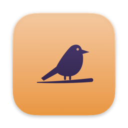
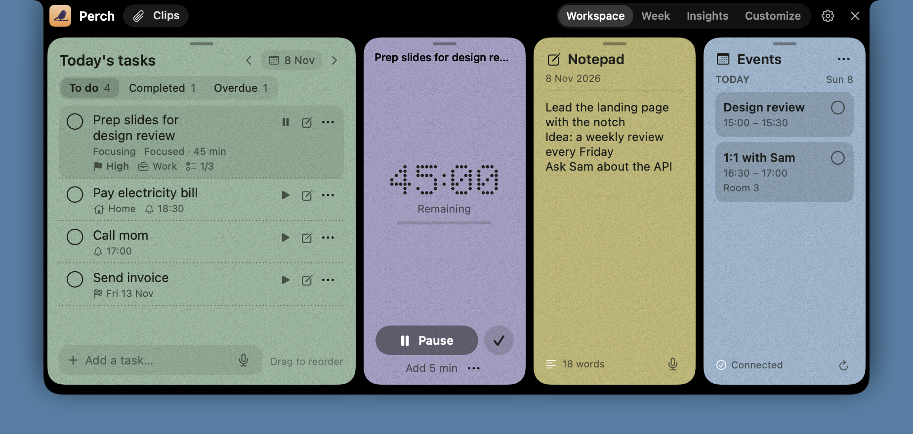
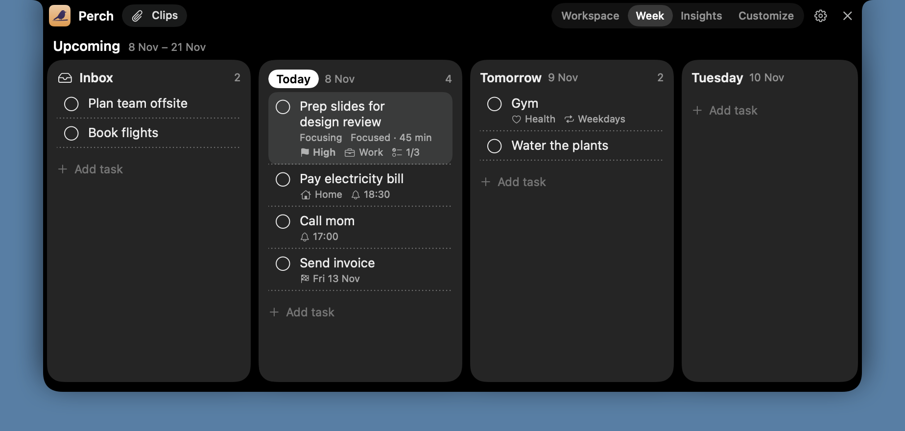
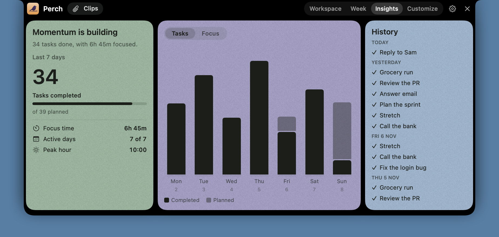
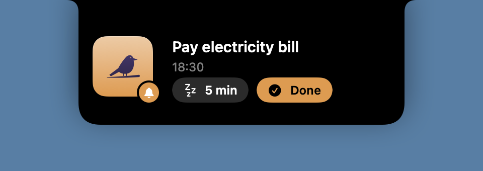

# Perch

Tasks, notes, focus timers, calendar events and recent clips, in your Mac's notch. Hover over the notch and it opens, and it closes when you move away. Option-N opens it from the keyboard, and then it stays until you press Option-N or Esc, or click elsewhere.



## What it does

- **Tasks you type the way you'd say them.** "water plants friday at 9am #home" goes on Friday, with a 9am reminder, in the Home project. Priorities, deadlines, repeats, steps and notes are there when you need them.
- **The week at a glance.** The Inbox sits beside the next 14 days, and tasks drag between them.
- **A notepad for each day.** Command-Return turns the current line into a task.
- **Focus timers** for a task or on their own, counting down or up. While the panel is closed, the time stays beside the notch.
- **Reminders that open in the notch,** with a snooze and a Done button. They still ring through macOS notifications while Perch is quit.
- **Today's calendar events**, read-only.
- **Clips:** your recent copied text, images and files, ready to drag into another app. Screenshots and screen recordings too, if you turn them on. Anything a password manager marks as private is never kept.
- **Insights:** what you finished, how long you focused and your peak hour.
- **Two-way Apple Reminders sync**, off by default, so your tasks reach your iPhone and Apple Watch. It hasn't been tried against real Reminders yet.
- **AI agents can use it.** Claude Code, the Claude app and Cursor can read, add, update, complete and delete tasks, set reminders, read and write notes, run the focus timer and read your insights.
- **Apple Intelligence fills in the gaps.** On macOS 26 with Apple Intelligence on, a new task gets a priority and project you didn't set, from the on-device model.
- **External monitors get a drawn notch,** which you can turn off. On a MacBook or iMac without a notch, push the pointer to the middle of the top edge and Perch opens below the menu bar.

| Week | Insights |
| --- | --- |
|  |  |

While the panel is closed, a reminder that's due and a running timer show up around the notch:




## Status

Perch is young. Everything above is built, but much of it hasn't been tried in the real app yet. [product.md](product.md) says what's confirmed working and what isn't, and the pinned [feature checklist](https://github.com/pitis/perch/issues/1) tracks the rest. There's no download yet, so you build it from source.

## Build and install

You need macOS 14 or later on Apple silicon, and Xcode. Xcode 16 should be enough, though it's only been built with Xcode 27 so far, and the Apple Intelligence suggestions need Xcode 26 or later.

```sh
git clone https://github.com/pitis/perch.git
cd perch
./scripts/build.sh --install
```

That builds `Perch.app`, puts it in `/Applications` and launches it. It has no Dock icon: it lives in the notch and the menu bar. It also takes over Option-N, so on a US keyboard that shortcut no longer types ñ.

The build is signed with the first Apple Development certificate in your keychain. Without one it's signed ad hoc, and macOS asks for permissions again after every rebuild. Any Apple ID can make one in Xcode › Settings › Accounts › Manage Certificates.

## Privacy

Perch makes no network requests. There's no account, no analytics and no update check. Your data is kept in `~/Library/Application Support/Perch/`, and it only leaves your Mac if you turn on Reminders sync, which goes through Apple's Reminders and usually iCloud, or connect an AI agent, which sends what it reads to its own service.

Clips keeps your last 40 copied items in that folder, as text and image files. Turn it off in Settings › Clips › Keep copied items.

macOS asks for each permission when you first use the feature that needs it:

- **Notifications**, the first time a task gets a reminder, so it can still ring while Perch is quit.
- **Calendar**, when you connect it, to show today's events. Perch only reads them.
- **Reminders**, when you turn on Reminders sync.
- **Microphone and Speech Recognition**, the first time you click the microphone. Speech becomes text on your Mac.
- **The folder your screenshots go to**, usually the Desktop, only if you turn on screenshots in Clips. Clips also keeps track of files you copy, so copying one from Desktop, Documents or Downloads may make macOS ask about that folder too.

AI agents reach Perch through a local socket that only your user account can open.

## Connecting an AI agent

In Settings › AI agents, click Connect next to Claude Code, the Claude app or Cursor. Perch adds itself to that app's config file and keeps a backup of the old one. The Claude app and Cursor need a restart, and Settings offers to do it. Claude Code picks the change up the next time it starts.

For another MCP client, add this to its config. It starts Perch if it isn't running.

```json
{
  "mcpServers": {
    "perch": {
      "command": "/Applications/Perch.app/Contents/MacOS/Perch",
      "args": ["--mcp"]
    }
  }
}
```

## How it's built

SwiftUI inside an AppKit panel, with no dependencies. `Sources/PerchCore` holds the logic, doesn't import AppKit, and is what `swift test` covers. `Sources/Perch` is the app around it. `swift build && .build/debug/Perch --snapshot <folder>` renders every screen to PNG with sample data. [AGENTS.md](AGENTS.md) has the details and the rules the code relies on.

## Credits

The feature set was inspired by [NotchOwl](https://www.notchowl.com/)'s public site and changelog. No code or assets come from it, and its app was never downloaded or inspected.

## License

[MIT](LICENSE)
